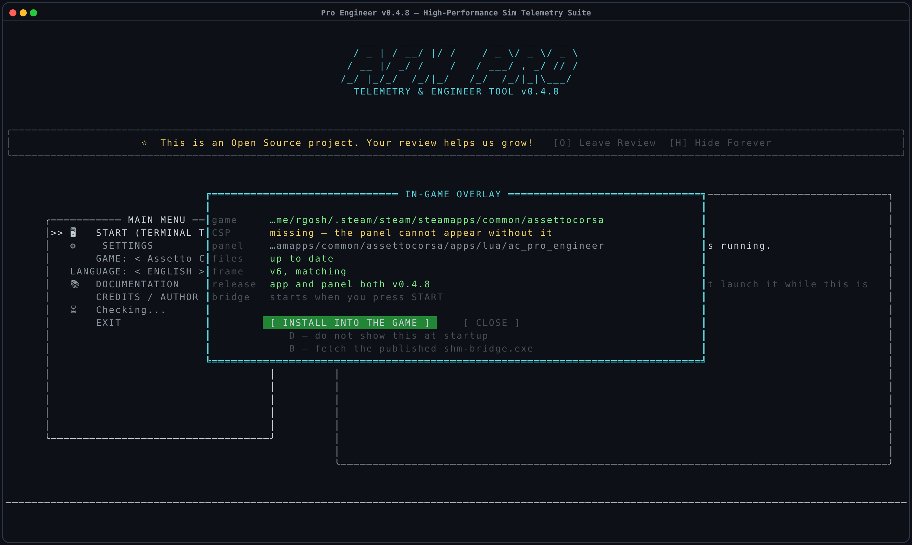

# 🏎️ Pro Engineer — Assetto Corsa & Competizione Telemetry, Race Engineer & In-Game Overlay

[](https://github.com/Rgosh/ac-pro-engineer/releases)
[](LICENSE)
[](https://github.com/Rgosh/ac-pro-engineer/stargazers)
[](#windows)
[](docs/guide/linux.md)
[](https://www.rust-lang.org)
[](https://github.com/Rgosh/ac-pro-engineer/actions/workflows/release.yml)

> ### 🆕 Assetto Corsa Competizione is supported, from v0.4.0
>
> ACC's telemetry is read the same way Assetto Corsa's is — dashboard, tyres,
> brakes, fuel, strategy and lap analysis all work on it, and the engineer
> judges a GT3 against a GT3's numbers. Its layout was measured off a recorded
> session rather than copied from a header file. Pick the game on the launcher:
> `GAME: < … >`.
>
> Two things to know before downloading for it: **there is no in-game panel on
> ACC** (it is a Custom Shaders Patch app, and CSP is an Assetto Corsa mod), and
> **ACC publishes no tyre wear or tread temperatures**, so that advice stays
> silent and brake pad life takes its place. [What each game
> reports](#which-simulator-and-what-it-reports) is the table below.

**Pro Engineer** is a free, open-source **Assetto Corsa telemetry app** and
**virtual race engineer** for sim racing, and it reads **Assetto Corsa
Competizione** too. It takes the game's shared memory directly, analyses tyre
temperatures and pressures, brake heat, fuel, lap deltas and driving style, and
gives you spoken-plain engineering advice while you drive — in a fast terminal
dashboard on your second screen **and**, on Assetto Corsa, in an **in-game
overlay** built as a Custom Shaders Patch (CSP) Lua app.

**Two simulators do not measure the same things**, and the program says which
is which rather than filling the gaps in: ACC publishes no tyre wear and no
temperatures across the tread, so the wear and camber advice go quiet on it and
brake pad life takes their place. [What each game
reports](#which-simulator-and-what-it-reports) is a table below, and the
launcher shows the same list for whichever game you pick.

It runs on **Windows** and on **Linux / Steam Deck under Proton**, costs about
**0.1 % of one CPU core**, and touches nothing in your game folder except its own
overlay app.

> **Keywords:** Assetto Corsa telemetry, ACC telemetry, Assetto Corsa
> Competizione telemetry app, AC telemetry app, sim racing telemetry software,
> virtual race engineer, GT3 brake wear, tyre pressure calculator, cold pressure
> calculator, fuel strategy calculator, stint planner, FFB clipping meter,
> MoTeC CSV export, ghost lap comparison, Custom Shaders Patch app, CSP Lua
> overlay, Assetto Corsa Linux, ACC Linux, Assetto Corsa Proton, Steam Deck sim
> racing, shared memory telemetry, ratatui TUI, Rust sim racing tools.



> ⭐ **If this is useful, star the repo.** It is the only marketing this project
> has.

---

## Contents

**In this README:** [what it does](#what-it-does) · [which simulator](#which-simulator-and-what-it-reports) · [install](#install) · [the family](#the-family-and-the-core-underneath) · [licence](#licence-and-credits)

**The guide** — every part of it on a page of its own, in [`docs/guide/`](docs/guide/README.md):

| | |
|---|---|
| [The in-game overlay](docs/guide/in-game-overlay.md) | the CSP panel window by window, and the Linux bridge |
| [Every screen](docs/guide/screens.md) | the terminal's tabs and the panel's windows, with pictures |
| [Sharing a session](docs/guide/sharing-a-session.md) | two machines, one network |
| [Keyboard](docs/guide/keyboard.md) | defaults, and how to rebind them |
| [Command line](docs/guide/command-line.md) | every flag of every binary |
| [Configuration file](docs/guide/configuration.md) | every key, and where it lives |
| [The UDP feed](docs/guide/udp-feed.md) | writing your own front end |
| [Troubleshooting](docs/guide/troubleshooting.md) | symptoms, causes, fixes |
| [Linux / Steam Deck / Proton](docs/guide/linux.md) | getting AC + CSP + CM to run at all |
| [For developers](docs/guide/developers.md) | architecture, tests, contributing |
| [Security](docs/guide/security.md) | why a telemetry reader looks suspicious |

**What the core does** — the engineer, the analysis and everything the
front ends draw, feature by feature, in [`docs/features/`](docs/features/README.md).

---

## What it does

**While you drive**, on a second screen or in the game itself:

- **Tyre thermal and pressure work.** Live pressure and inner/middle/outer
  temperature per corner, the distance from your target hot pressure, and a
  **cold pressure calculator** that tells you what to set in the setup screen to
  arrive at that target once the tyres are up to temperature.
- **A race engineer that groups what it sees.** Four cold tyres is one sentence,
  not four. Advice is ranked by severity, and the same lines reach the in-game
  overlay — up to eight of them, however many you ask for.
- **Advice as a plan, not a pile.** Within a severity the findings follow the
  order a race engineer changes things in — pressures, then what the tyre does
  at that pressure, then camber, the brake bias and the car around it — and a
  finding another one moves says it waits for it: tyre heat and camber wait
  for the pressure, the brakes' heat waits for the bias. When there is more
  than one change to make, the first one says *start here: one change at a
  time, three clean laps before the next*.
- **Every finding explains itself.** The mechanism, the measurement, and what
  to look at on the next run to know whether the change worked — with the
  setting to change and the number to change it to, in the car's own units.
- **A coach after every lap.** The corner that cost the most against your best
  becomes one instruction — "brake 12 m later into T5" — and stays on that
  corner until it is fixed.
- **Fuel and stint strategy.** Consumption per lap measured from your own laps,
  laps remaining, fuel needed to finish, and how short you are.
- **Lap timing with a real ghost.** Delta against your own recorded best lap
  rather than whatever reference the game picked, plus sector splits on tracks
  with two, three or four sectors.
- **FFB clipping.** Whether your wheel is saturating and losing every detail
  above the clip point.
- **Driving style analysis.** Smoothness, aggression, trail braking, lockups,
  wheelspin, coasting and scrubbing, counted rather than guessed.

- **Somebody else's session, on your screens.** One person drives; the other
  presses `W` and watches — the dashboard, the traces, the map, the corner
  table and the engineer, all of the driving happening on the other machine,
  in your own units and your own language. It works between the terminal and
  the window in any combination, and the two copies find each other on the
  network rather than anybody reading an IP address out loud.

**Between sessions:**

- **Lap history and comparison**, with a ghost trace overlaid on yours.
- **MoTeC-compatible CSV export**, named after the car, track and lap.
- **Setup Cloud** — browse community setups by car and install them into AC
  without restarting the game.
- **A built-in guide**: sixteen chapters on braking, differentials, aero,
  tyre thermodynamics, suspension frequencies, dampers, FFB and wet setups.

**And the things that are usually missing:**

- **It computes nothing in the game.** The desktop side does the work; the CSP
  panel reads a 2484-byte struct and draws it. Lua runs on Assetto Corsa's render
  thread, so anything else would be a stutter.
- **Everything in the overlay can be switched off**, block by block.
- **Every keyboard shortcut can be rebound**, and every on-screen hint is printed
  from the binding, so it cannot tell you the wrong key.

---

## Which simulator, and what it reports

Pick the game on the launcher — `GAME: < … >`, on every platform. It is a
choice rather than a guess, because both games publish their telemetry under
*the same three names*, and on Linux the helper that carries it has to be
started inside one game's Proton prefix before that game runs. There is nothing
to detect at the moment it matters, and a wrong guess is expensive: the helper
in the wrong prefix, or a race engineer running the other game's thresholds.

| What the game reports | Assetto Corsa | Competizione |
|---|:---:|:---:|
| Live telemetry — speed, revs, fuel, position | ✅ | ✅ |
| Tyre pressures and temperature | ✅ | ✅ |
| Tread temperatures — **the camber advice** | ✅ | ❌ |
| Tyre wear | ✅ | ❌ |
| Brake temperatures | ✅ | ✅ |
| **Brake pad and disc wear** | ❌ | ✅ |
| Track grip as a number | ✅ | ❌ |
| Track limits — whether the lap counted | ❌ | ✅ |
| Sector times | ✅ | ✅ |
| Setups read from disk | ✅ | ❌ |
| The in-game panel | ✅ | ❌ |
| Track length in metres | ✅ | ❌ |

**A cross is a feature, not a gap.** A field a game does not publish reads as
zero, and zero is a confident wrong answer — four tyres with no tread left, a
perfectly cambered car, an ice-rink of a track. So the advice that rests on a
measurement a game does not make says nothing at all, and the launcher tells
you which those are before you start. `cargo run -p ac_core --example
capability_matrix` prints this table out of the program itself.

Two things are worth knowing before downloading for ACC:

- **The panel is Assetto Corsa's.** It is a Custom Shaders Patch app and CSP is
  an AC mod; ACC is Unreal Engine and has nothing to load it. On ACC the
  product is the terminal and the network feed.
- **ACC's telemetry is measured, its thresholds are not verified.** The layout
  was pinned to a recorded session — a GT3 at Spa, 337 seconds of it, in this
  repository — so the numbers are right. The engineer's temperature thresholds
  were chosen against Assetto Corsa's cars and have not yet been read against a
  GT3 stint. `docs/plan-acc.md` §10 is the list of what that still needs.

Other simulators are entries in the registry with a sentence each about what
stands in the way — see [For developers](docs/guide/developers.md#for-developers).

---

## Install

### Windows

1. Download the latest `ac_pro_engineer` from the
   [Releases page](https://github.com/Rgosh/ac-pro-engineer/releases).
2. Unzip it anywhere and run `ac_pro_engineer.exe`.
3. Start Assetto Corsa.

That is all. The application finds your Assetto Corsa install by itself, writes
the in-game panel into `assettocorsa/assets/frontends/csp-panel/` on startup, and
creates the shared memory the panel reads. There is no bridge and nothing to
start in a particular order.

### Linux / Steam Deck

1. Install **protontricks**, and **not as a Flatpak** — see below.
2. Download the Linux archive from the
   [Releases page](https://github.com/Rgosh/ac-pro-engineer/releases) and unpack
   it. `wineshm.exe` sits next to `ac_pro_engineer` — keep them together.
3. Run `./ac_pro_engineer` and press **START**. The bridge is launched inside the
   Proton prefix of the game you chose, and stopped when you come back to the
   launcher.
4. Start Assetto Corsa.

**The bridge is not optional, and it is not only for the overlay.** This said the
opposite for several releases, and it cost at least one person an evening. Under
Proton the game is a Windows process and its telemetry pages exist only inside
the prefix; `wineshm.exe` is what mirrors them out to `/dev/shm`, which is
where the Linux binary reads them. Without it running there is no telemetry on
this side at all — for the tabs as much as for the panel. The overlay needs it
for the opposite direction as well: the application writes its frame into
`/dev/shm` itself, and only a Windows process inside the prefix can give that
file the Win32 name CSP is allowed to open.

**Starting it by hand** is the fallback when the application cannot, and the way
to see what it says:

```bash
protontricks-launch --appid 244210 wineshm.exe
```

**protontricks must not be a Flatpak.** A Flatpak has a `/dev/shm` of its own, so
a bridge inside one creates the pages in a tmpfs that exists only in that sandbox
— the bridge reports success, and nothing outside can see a byte of it. Its
private `/tmp` is a second wall: Wine's server socket lives in `/tmp/.wine-$UID`,
so the sandboxed bridge cannot reach the running game's prefix to mirror from in
the first place. This is the default install on some distributions — Bazzite
among them — and it is why "the bridge does nothing" is the most common Linux
report. A user-level `pipx install protontricks` needs no layering and no reboot
on an immutable system.

**With the game running, this is the proof it is through:**

```bash
ls -l /dev/shm/acpmf_physics
```

2048 bytes means the telemetry is reaching the Linux side. No file means the
bridge is not.

If Assetto Corsa itself does not run properly under Proton yet, do
[the prefix setup](docs/guide/linux.md#linux--steam-deck--proton) first — that is a separate problem
and it has its own section.

### From source

```bash
git clone https://github.com/Rgosh/ac-pro-engineer.git
cd ac-pro-engineer
cargo run --release
```

Needs a recent stable Rust. To build the Linux bridge as well you need the
Windows target and MinGW:

```bash
rustup target add x86_64-pc-windows-gnu
```

```bash
cargo build --release --target x86_64-pc-windows-gnu   # in the wineshm checkout
```

Or use the packaging script, which does both and lays out an archive:

```bash
./build_release.sh
```

---

## The family, and the core underneath

Three programs read one core, so they can never tell you two different
things about the same lap:

| Program | What it is | Source |
|---|---|---|
| **Pro Engineer** | this terminal, and the in-game CSP panel | here, AGPL |
| **[RG Pro Engineer](https://proengineer.app/rg/)** | the same engineer in a desktop window — analysis, traces, a map of the real circuit, an overlay drawn inside the game's own picture | closed, free |
| **[Pro Launcher](https://proengineer.app/launcher/)** | an Assetto Corsa launcher for Windows and Linux, with the engineer on both sides of every drive | closed, free |

Everything that *decides* anything lives in this repository's `core`, and the
two closed programs only draw what it says. That is also why the core reads
far more of Assetto Corsa than a telemetry tool needs — it is the launcher's
whole understanding of the game:

| Module (`core/src/games/assetto_corsa/`) | What it reads or does |
|---|---|
| `lobby`, `server_details`, `server_slots`, `local_servers` | the public server list the way the game asks for it; each server's sessions, rules and forced aids; who is on it and which cars have a free place; servers on the local network |
| `join_link` | race invitations — `acmanager://` links and acstuff join pages, as chats mangle them |
| `weather_fx`, `real_weather` | Custom Shaders Patch's thirty-three weather types, rain and snow included, and schedules of them; the weather at the real circuit now from its geotags |
| `csp`, `csp_settings`, `csp_config`, `csp_presets` | the patch installed or not, its modules, every setting as the patch describes it, and presets in Content Manager's format both ways |
| `mod_config`, `apps` | every mod's own INI settings (weather scripts such as Pure and Sol, controllers, filters, apps) with their authors' labels, changed in place with the original kept; Python apps switched on and off |
| `adding`, `packs`, `health` | mods installed from any archive at any depth, archives inside archives; content grouped by pack and brand; every car and circuit checked for what the game will not load |
| `video`, `assists`, `levels`, `setups`, `setup_sheet` | the game's settings and setups, read and written in its own format |
| `results`, `championship`, `backup` | every session's result kept, championships scored from them, the game's settings backed up and restored |
| `content_manager` | what a driver built up in Content Manager — server lists, aid presets, patch presets — found so it can come along |
| `game_log`, `preflight` | why a session never began, and what can be checked before it starts |

Every reader of outside text — links, presets, lists, results, server and
weather answers — is fed thousands of seeded pieces of nonsense by a test
(`robustness`) and must answer or refuse, never fall over.

## Licence and credits

Released under the [GNU AGPL v3](LICENSE). Free to use, free to fork, free to
build on — provided what you build stays open. [LICENSING.md](LICENSING.md) is
the plain-language version:

- **Racing with it, reading it, forking it** — nothing to do, it is free.
- **Changing it for yourself and never passing it on** — nothing to do either.
  The licence conditions distribution, not what runs on your own rig.
- **Building on it and publishing the source** under the AGPL — nothing to ask.
  Keep the notices, credit the project.
- **Keeping your own source closed** — needs written permission, in advance:
  <rgoshbbb@gmail.com>.
- **Selling a product with this inside it** — a commercial licence, same
  address. Terms per case; there is no price list.

Versions up to and including **v0.3.6 were MIT** and stay MIT; that grant
cannot be withdrawn. The AGPL applies from v0.3.7 onward.

`wineshm` began as [Damir Jelić's](https://github.com/poljar) work on bridging
Wine shared memory and is used and extended here **under its own MIT licence**,
which this project's change does not touch.

Built with [ratatui](https://ratatui.rs), [tokio](https://tokio.rs) and
[Custom Shaders Patch](https://acstuff.ru/patch/). Not affiliated with Kunos
Simulazioni.
