[← Guide](README.md) · [Main README](../../README.md)

# Every screen

Both faces of the application: the terminal's launcher and ten tabs first,
then the in-game panel's five windows and every tab of its settings. The
terminal pictures come from `cargo run --bin tui_tester` and the panel's from
[`apps/lua/love/portraits.sh`](../../apps/lua/love/portraits.sh) — both draw with the
real code, so a screenshot here cannot be out of date with the build that made
it.

### Launcher

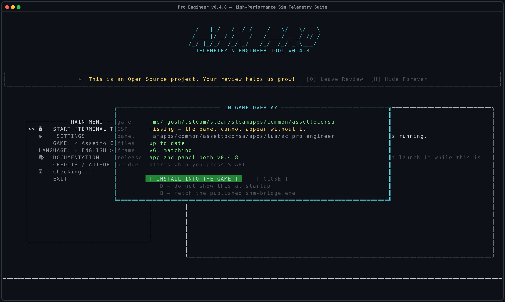

Where the application waits before a session, and where it reports what it found:
your Assetto Corsa install, whether CSP is there, whether the overlay is current,
and which bridge is running. `↑/↓` to move, `←/→` to change a value, `ENTER` to
open, `Q` to quit.

### 1 — Dashboard

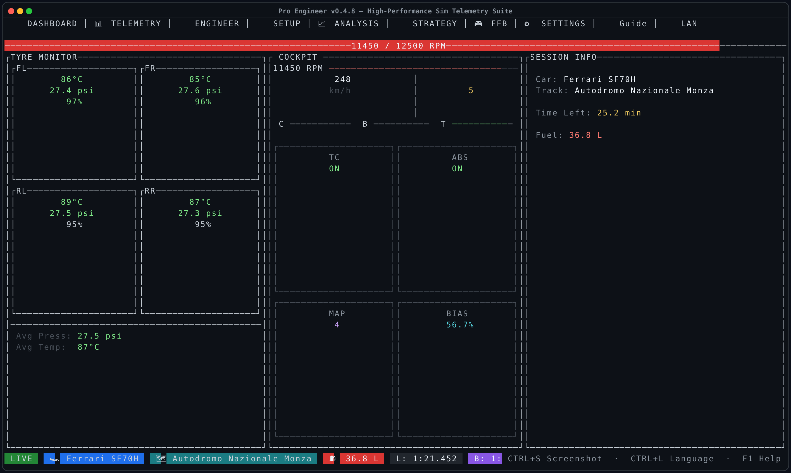

Mission control. Per-corner tyre temperature, pressure and life; speed, gear and
a shift bar that turns colour through the power band rather than at the limiter;
TC, ABS, engine map and brake bias; session, car, track, fuel and time remaining.

### 2 — Telemetry

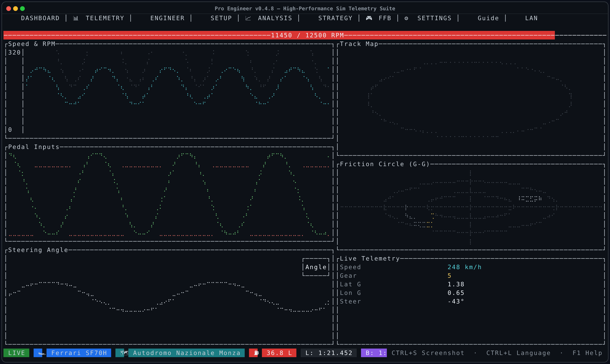

The raw feed: dynamic pressures, tyre core temperature, suspension travel, and a
friction circle showing lateral against longitudinal g. Use it on an out-lap to
watch the tyres come in evenly.

### 3 — Engineer

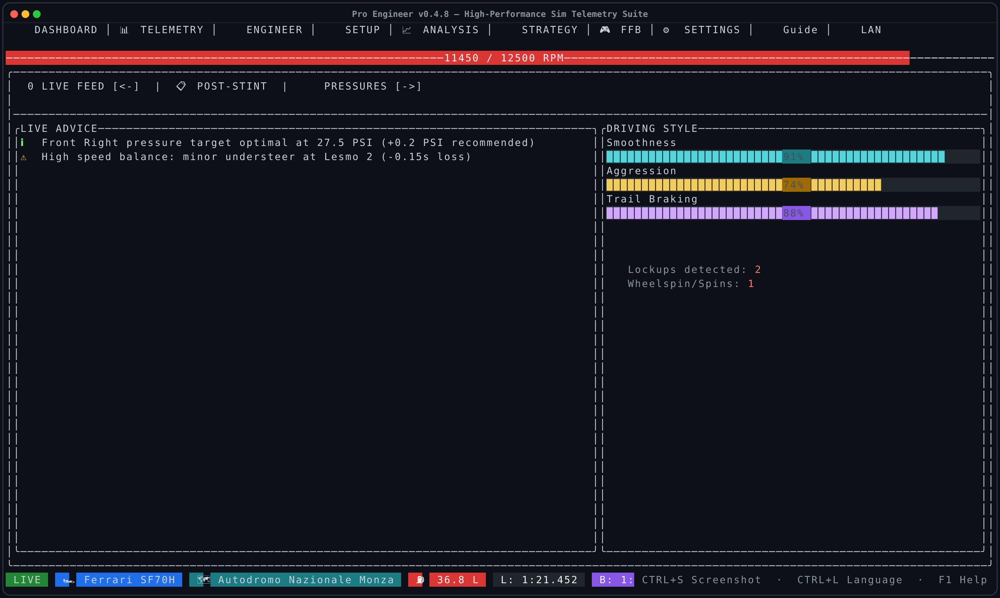

Three sub-tabs, `←/→` between them:

- **Live feed** — the advice as it is generated, with severity, next to a driving
  style read-out: smoothness, aggression, trail braking, lockups, wheelspin.
- **Post-stint** — the debrief for a finished stint, lap by lap.
- **Pressures** — the cold pressure calculator and a per-corner optimiser: what
  each corner is at, what it should be, and how much to add or let out.

### 4 — Setup

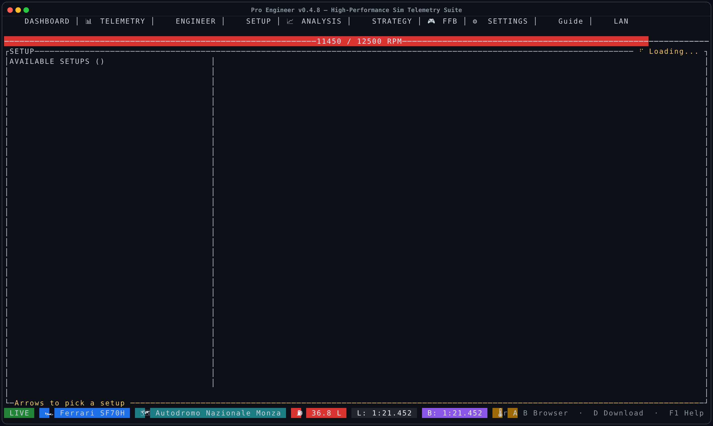

Your local setups for the current car, compared field by field against a
reference. Press `B` for the **Setup Cloud**:

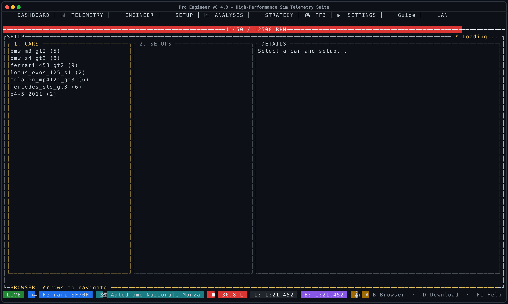

Browse by car, read the setup's details, and press `D` to install it straight
into Assetto Corsa. No restart.

### 5 — Analysis

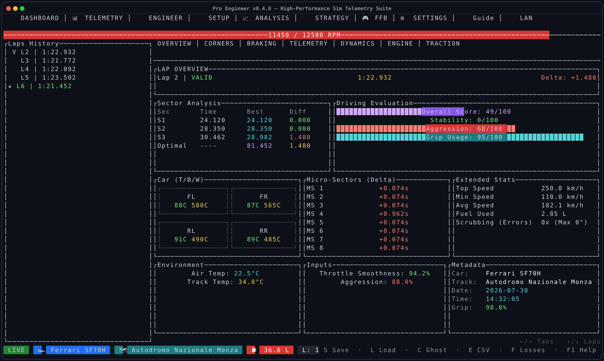

Lap history and traces: throttle, brake, steering and speed against distance,
with a ghost lap overlaid. `S` saves the selected lap, `L` loads one from disk,
`C` toggles the ghost, `E` exports MoTeC-compatible CSV.

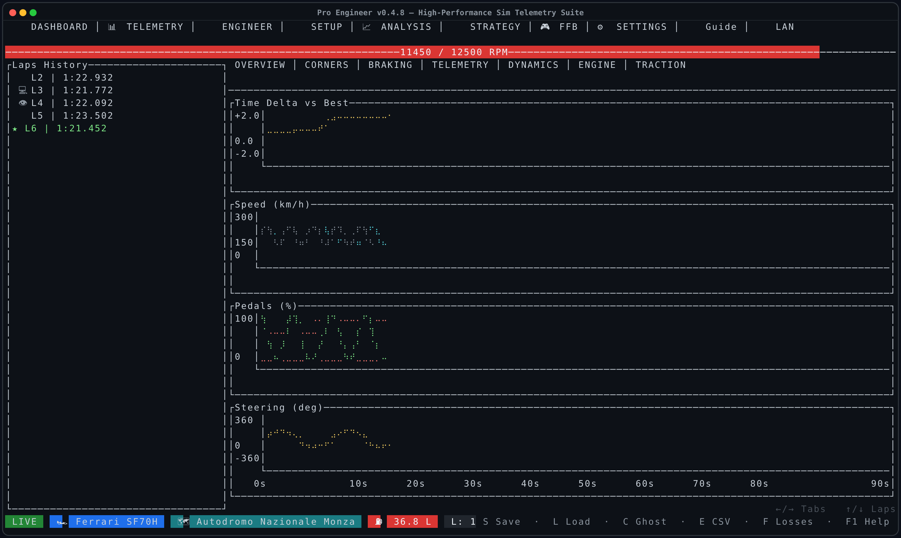

`←/→` moves between six sub-tabs. **TELEMETRY** is the traces above — delta
against your best, speed, both pedals and steering against time. **DYNAMICS**,
**ENGINE** and **TRACTION** break the same lap down further, and **OVERVIEW**
carries the sector split, the driving scores and the per-corner temperatures.

**CORNERS** is where the lap actually went.

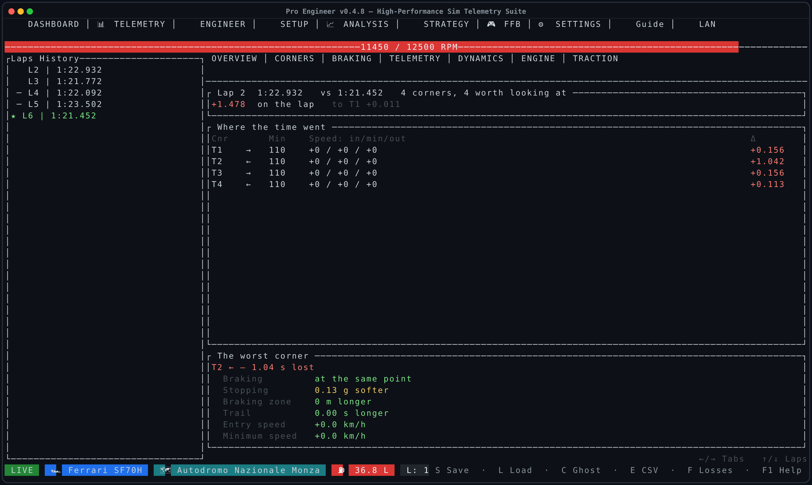

Corners are found in the trace — a stretch where lateral load stays up long
enough to be a corner rather than a kink — so it needs no track data and works
on mods. Each one is charged the track from its own entry to the next corner's
entry, which is where a bad exit is actually paid for, and the per-corner
deltas plus the run to T1 add up to the lap's own delta.

`F` hides everything that cost less than a tenth:

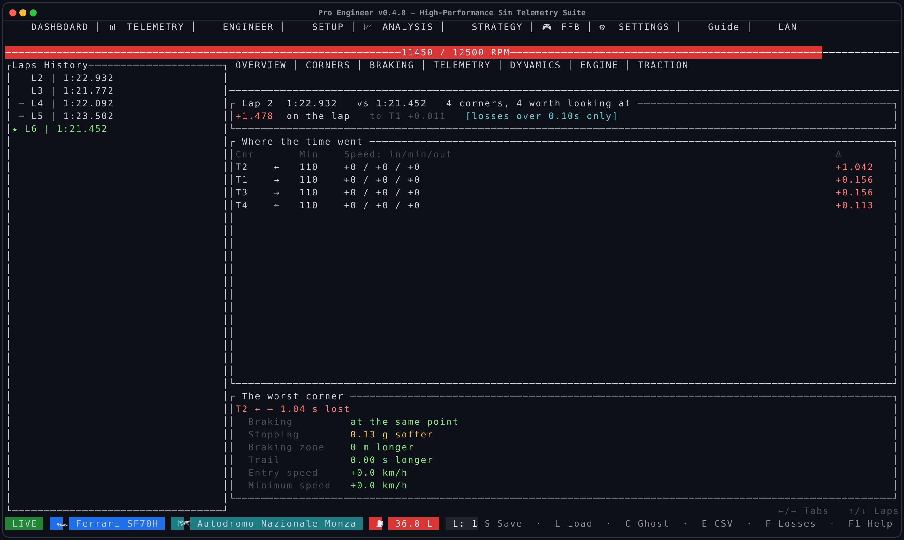

That filter is the point. Twenty corners with a number beside each is another
table to read; the three that cost real time is a job. Under it, the worst
corner is pulled apart — braking point in metres, entry, minimum and exit
speed, and how much later the throttle came back.

Two things it will not do. A corner the reference lap does not have is drawn as
**no comparison** rather than as a delta of zero, because two laps of the same
track can detect a different number of corners and matching them by position in
the list compares T5 against something else entirely. And braking in metres
needs the track's length, which laps saved before v0.3.7 do not carry — it says
"not measured" rather than inventing a number.

### 6 — Strategy

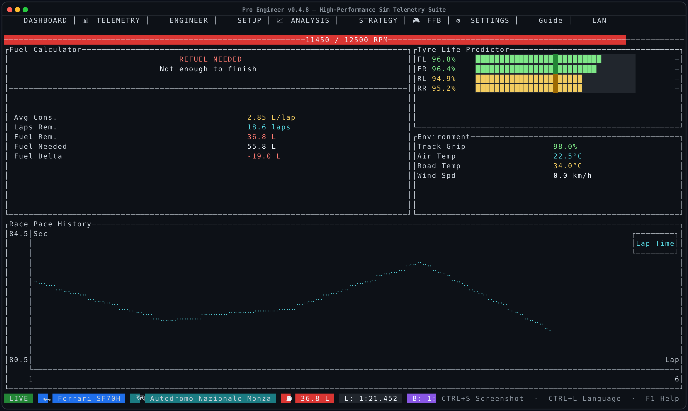

The pit wall. Fuel per lap measured from your own laps, laps remaining in the
tank, fuel needed to finish and how far short you are; tyre life projected
forward; track grip, air and road temperature.

### 7 — FFB

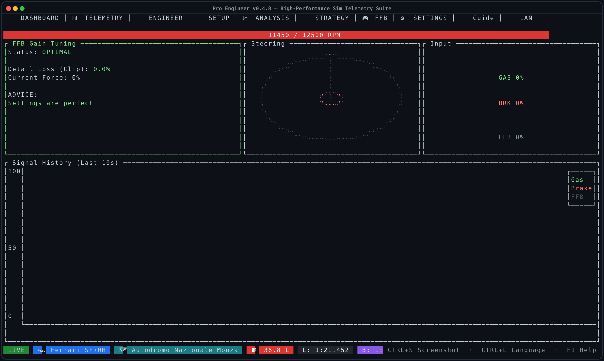

Force feedback clipping over time, with the input traces beside it. If the graph
is red you are driving blind through the wheel — lower the gain in AC until the
peaks barely touch yellow.

### 8 — Settings

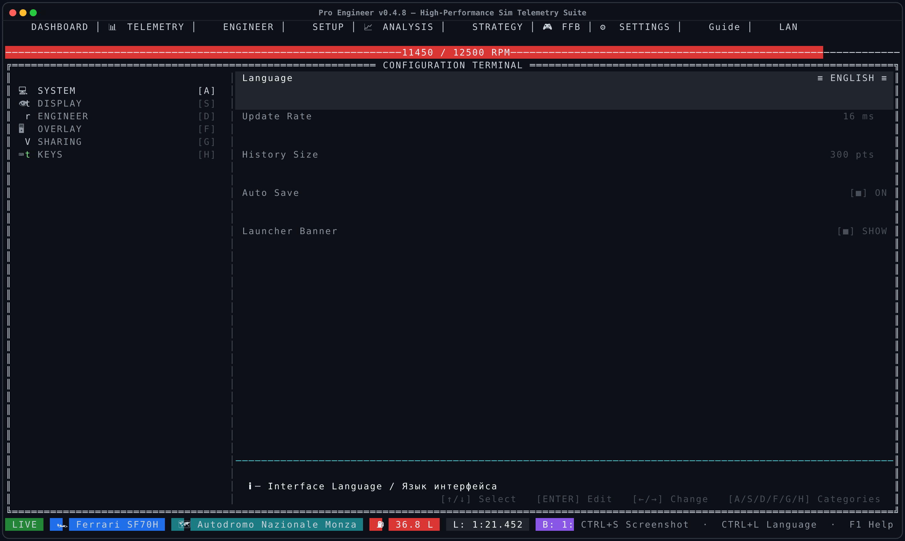

Six categories, `A` `S` `D` `F` `G` `H` or `←/→`:

- **SYSTEM** — language, update rate, history size, autosave
- **DISPLAY** — pressure and temperature units
- **ENGINEER** — every alert threshold, target hot pressures, ghost delta
- **OVERLAY** — which blocks the overlay gets, how many advice lines,
  `[I]` install / `[U]` uninstall the panel, and `[C]` for diagnostics
- **SHARING** — readings a second, only-while-on-track, the quiet timeout,
  being findable, and whether a session is accepted from the whole network
- **KEYS** — rebind anything

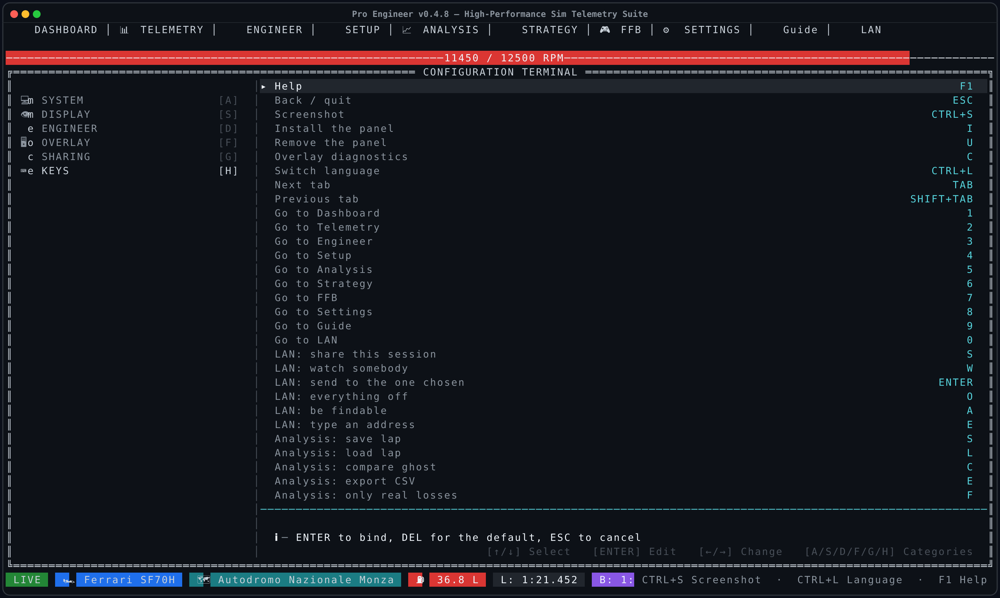

`[C]` on **OVERLAY** answers the one question this program gets asked most —
*why is the panel blank* — without leaving the application:

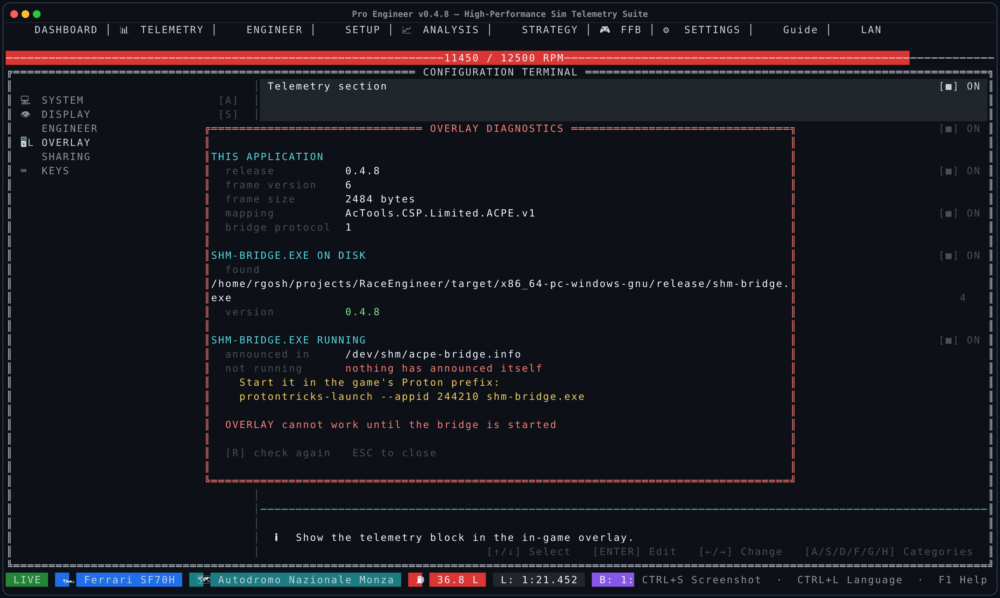

All three pieces that have to agree about a frame, what each one is, and what to
do about the one that does not fit. `[R]` measures again, so starting the bridge
in another window and pressing it is the whole loop. The same report is printed
by `cargo run -p ac_core --example bridge_probe` for anyone already in a
terminal.

### 9 — Guide

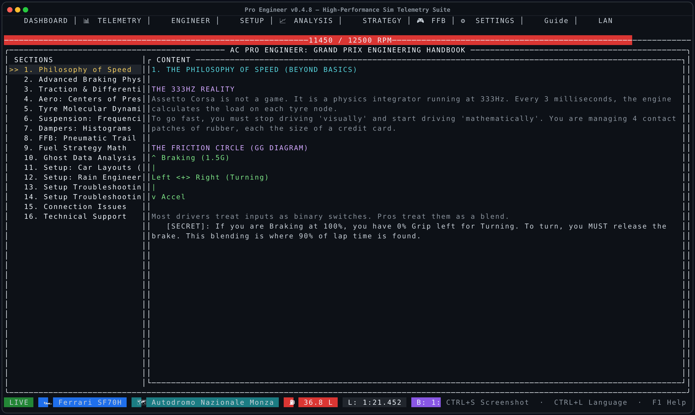

Sixteen chapters of setup and physics reference, from trail braking to wet
setups to a troubleshooting index. `↑/↓` to move between them.

### 10 — LAN

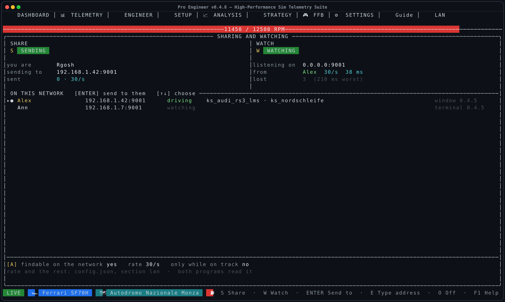

Sharing this session and watching somebody else's. Two switches — `S` and `W` —
the list of every copy the network has heard from, and what the link is doing:
who is sending, at what rate, how old the picture is, how many readings never
came. `Enter` aims at whoever the cursor is on. Nothing on this screen opens a
socket while you are looking at it: it writes down what you asked for, and the
telemetry thread reconciles it on the next tick.

The half nobody looks at twice — the rate, only-while-on-track, the quiet
timeout, and whether a session is accepted from the whole network or only from
this machine — is **Settings → SHARING `[G]`**.

### Help

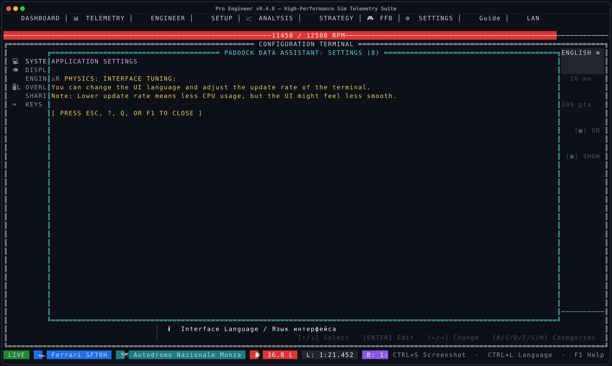

`F1` or `?` anywhere opens a page about the tab you are on. Every key it names is
printed from your bindings.

### In-game — the panel

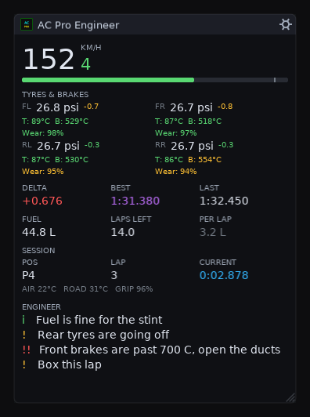

The window CSP opens as **Pro Engineer**, and the one that is on screen while
you drive. Top to bottom: speed with the gear beside it, a rev bar that changes
colour through the power band and marks your shift point rather than the
limiter, a **LIMITER** badge in the pits, then the four corners — pressure with
its distance from your target, tyre temperature, brake temperature and life —
then delta, best and last lap, fuel in the tank with laps left and consumption
per lap, and the session: position, lap, air and road temperature, track grip.
The engineer's lines close it off.

Every block on that list can be switched off, and so can most of the fields
inside them. **One-line mode** reduces the whole thing to speed, gear, delta and
fuel.

### In-game — advice

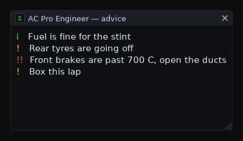

The same engineer lines as the block at the bottom of the panel, in a window of
their own — so they can sit where your eyes already go instead of pushing the
numbers down. Up to eight lines, however many you asked for.

Severity travels with each line rather than being guessed from the words:
`i` green for information, `!` yellow for a warning, `!!` red for critical, the
same three the terminal uses. The marker carries the colour and the sentence
stays in the reading colour, because a wall of red is a wall nobody reads.

### In-game — the lap debrief

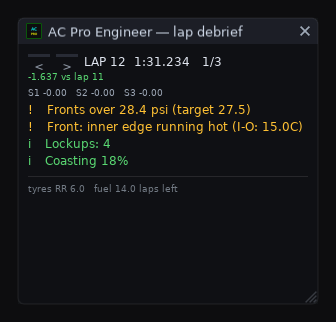

What the engineer made of the lap you have just finished — pressures and
temperatures against your windows, camber per axle, brakes, and how it was
driven. `<` and `>` page through the last three laps.

The paging is local to the panel. The frame only travels one way, so the
application publishes the recent laps and the window picks between what has
already arrived: it works with the game paused and asks the application for
nothing. How many lines to draw, whether to show the lap time and whether a new
lap jumps the window back to it are all in Settings → Debrief; setting the lines
to zero stops the application publishing a debrief at all.

### In-game — telemetry

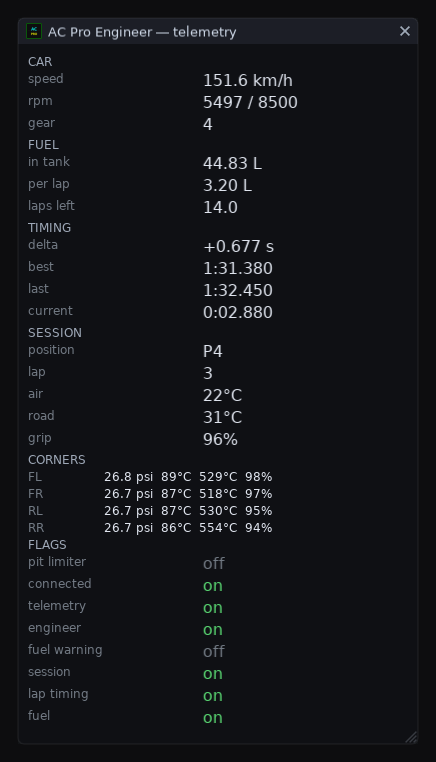

Every field in the frame, as it arrived, with no interpretation on top: car,
fuel, timing, session, the four corners in a row each, and the flag bits the
application is sending. It answers the one question the panel deliberately does
not — *is this number reaching the game at all* — and it is the window to open
when a block is blank and you want to know whether the value is missing or the
switch is off.

### In-game — status

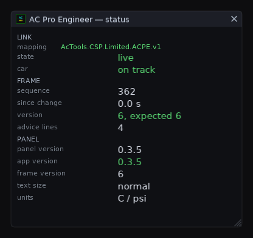

The link, in three parts. **LINK** — the mapping's full name, whether it opened,
whether the frame is live or stale, and whether there is a car on track.
**FRAME** — the sequence counter, how long since it last moved, the frame
version against the one this panel expects, and how many advice lines arrived.
**PANEL** — the panel's version, the *application's* version, and the frame
version.

Those last two are why this window exists. The panel version and the app version
are the only way to notice that Assetto Corsa loaded an older copy of the
application than the one now on your disk — from every other angle the files are
current, the versions match and the panel keeps drawing.

### In-game settings — Panel

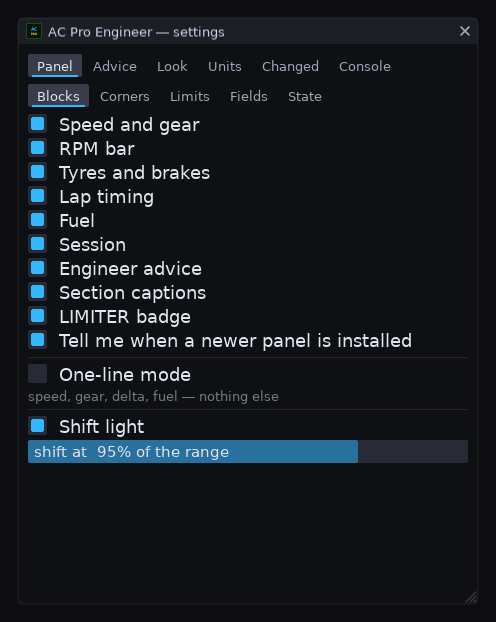

Which blocks the panel draws, in five sub-tabs.

- **Blocks** — every block on or off, section captions, the LIMITER badge, the
  update notice; one-line mode; the shift light and where in the rev range it
  comes on.
- **Corners** — whether each corner shows tyre temperature, brake temperature,
  wear and the distance from your target pressure, and how many decimals a
  pressure gets.
- **Limits** — the thresholds that decide the colours: cold / working / over for
  tyre and brake temperature, and good / worn for life. These are yours, because
  a slick at 95 °C is in its window and a hard at 95 °C is stone cold.
- **Fields** — which individual readings appear inside timing, fuel and session,
  and whether the panel lays them out in two columns, three, or picks.
- **State** — what the desktop application is actually sending, flag by flag.
  A block needs both its flag here and its switch in **Blocks**, and without
  this tab a ticked box with nothing on screen looks like a bug.

### In-game settings — Advice

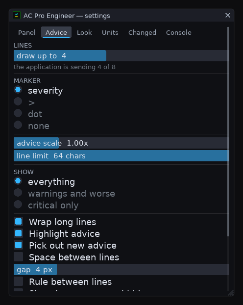

How much the engineer says and how it reads. How many lines to draw, of the
eight the frame can carry, with the number actually arriving printed
underneath — "I asked for eight and see three" is the engineer having three
things to say, and nothing else can tell you that. The marker style, the advice
text scale and where lines are cut. A severity floor, so the panel can be set to
warnings only or critical only. Then wrapping, highlighting, spacing, a rule
between lines, a count of what was hidden, and a plate behind the text for
reading a sentence against a bright sky.

### In-game settings — Debrief

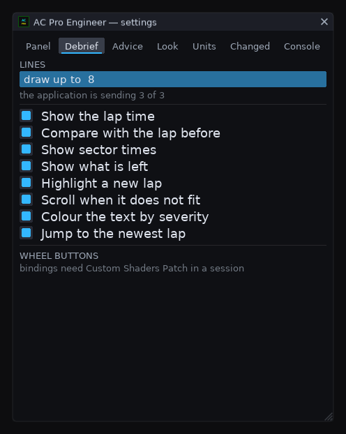

How much the lap debrief says and how you move through it. Lines to draw — zero
switches it off and the application stops publishing one at all — the lap time,
the comparison with the lap before, sector times, what is left of the tyres and
fuel, and whether a finished lap pulls the window back to it.

Underneath: how it looks. A backing plate from transparent to solid black, text
size, line spacing, a rule between lines and upper case — its own numbers rather
than the advice window's, because the two are read in different places.

Paging between laps is `<` and `>` in the window itself.

### In-game settings — Look

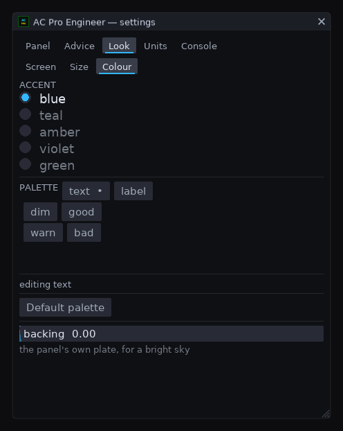

Three sub-tabs.

- **Screen** — presets first, because a panel that opens unreadable at 4K is a
  panel nobody gets as far as configuring; then whether the panel grows with its
  window or keeps a fixed size.
- **Size** — text scale, content width and rev bar height as sliders, three text
  size tiers, and a VR mode: largest text, thicker bar, more air between blocks.
- **Colour** — an accent colour, and a fully editable palette. The swatches
  choose which colour you are editing and one picker edits it, because CSP's
  colour *button* is a swatch that opens nothing. There is a reset, and a
  backing slider for the panel's own plate.

### In-game settings — Units

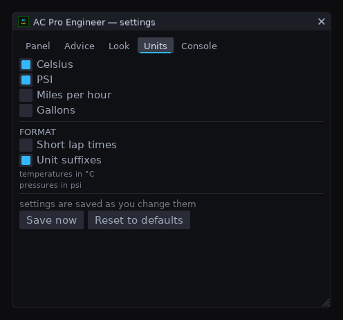

°C or °F, psi or bar, km/h or mph, litres or gallons, whether lap times are
written short, and whether numbers carry their unit. Every one re-formats the
panel immediately rather than at the next lap.

Underneath: whether CSP's storage is available at all, `Save now` and
`Reset to defaults`, and what the last save actually did. Settings are written
as you change them, and a button that saves silently is a button people press
twice and still do not believe.

### In-game settings — Changed

Everything that differs from the defaults: what it is now, what it was, a search
box, and a reset beside each line. The tab carries the count in its own label,
so *have I changed anything* is answered without opening it — and when the panel
is behaving oddly, the setting you do not remember touching is on this list.

The names are the settings file's keys rather than the captions, deliberately:
the list and `ac_pro_engineer_overlay.lua` are then the same vocabulary, so
*which line do I edit* has one answer.

### In-game settings — Console

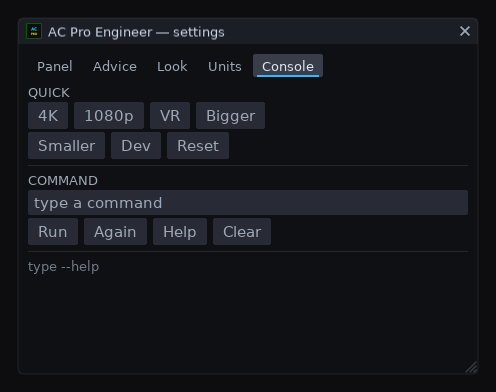

For what has no widget, and for what is faster to type than to find. One-press
presets for 4K, 1080p, VR, bigger, smaller, developer mode and reset; then a
command line taking `--scale`, `--width`, `--bar`, `--backing`, `--accent`,
`--vr`, `--units`, `--lines`, `--palette`, `--reset` and `--dev-mode`. That last
one is the only way to *turn on* developer mode — the Dev tab can only switch
itself off. `--help` lists the rest.

### In-game settings — Dev

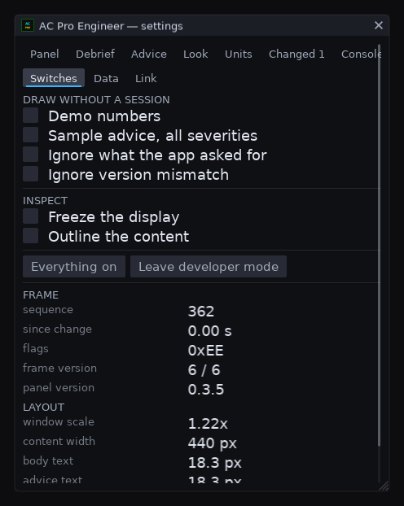

Red, and only in the window once developer mode is on — from the console's
`Dev` button or `--dev-mode`.

**Draw without a session** makes the panel lie on purpose: demo numbers, sample
advice at every severity, ignore what the application asked for, ignore a
version mismatch. That is how a layout gets judged without a car on track, and
how a block you cannot currently trigger gets looked at. **Inspect** freezes the
display and outlines the content rectangle. Below that, the frame's sequence,
age, flags and versions, and the layout's measured scale, width and text sizes —
the numbers behind the numbers.

The raw frame and the link state are here too, as the **Data** and **Link**
sub-tabs, so one window answers "what is going on" instead of three.

---
