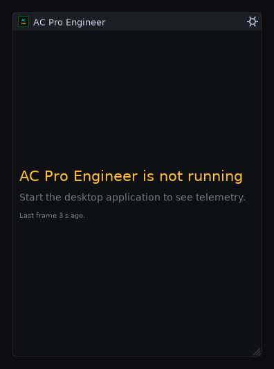

[← Guide](README.md) · [Main README](../../README.md)

# Troubleshooting

### The application says "AC NOT RUNNING" with Assetto Corsa open

The status bar tells three states apart on purpose:

- **AC NOT RUNNING** — no `acs.exe` process was found. On Linux, make sure you
  are running the game, not just the launcher.
- **AC RUNNING – NO DATA** — the process is there and its shared memory cannot be
  read. On Linux this is almost always `wineshm.exe` not running in the
  prefix. On Windows, try starting the application before the game.
- **LIVE** — telemetry is arriving.

### The in-game panel says "Waiting for Pro Engineer"



In order, cheapest first:

1. **Is the desktop application running?** The panel draws nothing without it.
2. **On Linux, is the bridge running in the prefix?**

   ```bash
   protontricks-launch --appid 244210 wineshm.exe --verify
   ```

   If it cannot open the mapping, start `wineshm.exe` in the prefix first.
3. **Is the bridge new enough?**

   ```bash
   cargo run -p ac_core --example bridge_probe
   ```

   A bridge older than the frame maps too few bytes and CSP refuses the mapping
   **without any error**. This is the single most common cause. Press **[B]** on
   the launcher's overlay card, or build a new one.
4. **Is the panel the one this build ships?** The overlay card on the launcher
   compares them. If the game was already running when the application updated
   the files, restart Assetto Corsa — the panel says so itself when it notices.

### The in-game panel says "Waiting for the car"

Nothing is wrong. The application is running and Assetto Corsa has no telemetry
yet — you are in the menus, on a loading screen, or in the garage before the
session goes live. The panel's settings and status windows work throughout.

### The panel says "Version mismatch"

The application and the installed panel disagree about the shape of the frame.
Reinstall the panel: **Settings → OVERLAY → `[I]`**, or

```bash
ac_pro_engineer --export-overlay ~/somewhere
```

and copy the folder into `assettocorsa/apps/lua/` yourself.

### The panel is not in CSP's app list at all

- Custom Shaders Patch has to be installed. The launcher's overlay card says
  whether it found it.
- The folder has to be `assettocorsa/assets/frontends/csp-panel/` — CSP finds an
  app's entry point by folder name.
- Enable **Pro Engineer** in CSP's app sidebar once.

### The panel forgets its settings

Fixed in v0.3.5. Older versions declared `LAZY = FULL`, which tells CSP to unload
the script when the last window closes. Update the application; it rewrites the
panel on startup.

### The overlay window is tiny / unreadable on a 4K screen

Settings → Look → Screen has presets for 1080p, 1440p, 4K and VR. Or type
`--scale 2 --width 680 --bar 12` in the Console tab.

### The terminal says "TERMINAL TOO SMALL"

The UI needs 80×20 to lay out. Resize the window; the application asks for
140×40 at startup but terminals are free to ignore that.

### A key does nothing / does the wrong thing

Settings → KEYS `[G]` lists every action with the key it is on. If a binding
shows as *unreadable*, `config.json` has a typo in it — press `DEL` on that row
to restore the default.

### Content Manager shows a black screen, or invisible text

That is a Proton prefix problem, not this application. See
[Linux / Steam Deck / Proton](linux.md#linux--steam-deck--proton).

### The engineer is telling me my tyres are worn out on lap three

Fixed in v0.3.5 — the critical threshold used to be derived from the warning one
and fired at 94 % tyre life. If you are on an older version, raise
`alerts.wear_warning`. On v0.3.5 the two thresholds are separate and settable in
Settings → ENGINEER.

### Where are my laps, exports and screenshots?

Under `data_path` in the config — by default the config directory, in
`laps/`, `exports/` and `screenshots/`.

### How do I report a bug usefully?

The **status window** in the game shows the panel version, the application
version and the frame version at once; `bridge_probe` prints the bridge's. Quote
those four, say Windows or Linux, and attach the log — by default under the
config directory in `logs/ac_engineer.log`. Run with `--log-level debug` if the
problem is a connection that comes and goes.

---
